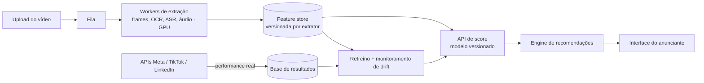

# Klike Data Science Challenge

Análise de 500 campanhas de vídeo (Meta, TikTok, LinkedIn), um modelo que prevê o `klike_score` antes do lançamento e uma engine que recomenda o que mudar no criativo. Por cima da engine, duas camadas opcionais: um simulador interativo e um agente revisor (LLM).

## Resumo de descobertas

- **Hook nos 3 primeiros segundos é a alavanca mais forte:** vale +16 a +19 pontos de score e +50–70% de CTR no geral, com efeito positivo em cada plataforma.
- **O que funciona depende da plataforma.** Rosto gera clique no TikTok (+75% CTR) e interação no Meta (+54% engajamento); vertical é o melhor formato no TikTok e o pior no LinkedIn.
- **O score parece um checklist de boas práticas + performance + ruído.** Uma regressão linear explica 71% dele só com atributos do criativo e contexto.


**Exemplo** (`python cli.py --campaign-id KLK-0262 --top 2`, resumido):

```
Campanha KLK-0262 · LinkedIn · SaaS · objetivo conversions
Klike score previsto: 47,6 (real: 46,7)

1. Adicionar um hook nos 3 primeiros segundos: +19,4 pts no klike_score previsto (47,6 → 66,9).
   No LinkedIn, campanhas assim têm CTR mediano +119% (IC 90%: +29% a +239%; n=45 vs 38). Esforço: médio.
2. Aumentar um pouco o texto na tela (densidade média): +8,7 pts (47,6 → 56,2).
   No LinkedIn, a diferença no CTR não é clara (+3%; IC 90%: −29% a +90%). Esforço: baixo.

Plano combinado (4 ações): score previsto 47,6 → 91,9 (+44,3 pts).
```

## Como rodar

Requer Python 3.10+.

```bash
python3 -m venv .venv
source .venv/bin/activate
pip install -r requirements.txt
pip install -e .                                  # instala o pacote local `klike` (src/klike)

python cli.py --campaign-id KLK-0127              # recomendações (--top N, --json)
pytest                                            # testes da engine
streamlit run app.py                              # simulador (engine + agente)

python -m ipykernel install --user --name klike --display-name "Python (klike)"
jupyter lab notebooks/                            # use o kernel "Python (klike)"
```

Os notebooks estão salvos com os resultados e podem ser lidos no GitHub. Nada exige chave de API: as revisões do agente usadas na UI e no notebook 04 estão em cache. Para revisões ao vivo, copie `.env.example` para `.env` e preencha `LLM_API_KEY` (no meu caso, optei por usar Gemini).

## Como pensei

Cada decisão está em [`docs/decisions.md`](docs/decisions.md) (D1–D15), no formato "o que vi → o que decidi → por quê → o que descartei".

**Dados** · `src/klike/data.py`
- 10 campanhas tinham impressões, spend ou CPC incoerentes. Corrigi o campo que contradizia os demais e marquei as linhas, sem descartar nenhuma (D1). Receita zero em awareness é estrutural, não faltante (D2).

**Parte 1 · EDA** · [`notebooks/01_eda.ipynb`](notebooks/01_eda.ipynb)
- Medianas com IC bootstrap sobre taxas, porque as métricas têm cauda longa e o n por grupo é pequeno (D3).
- Todo efeito foi checado por plataforma e ajustado pelo contexto, para separar efeito real de efeito de mix (D4). Duração quase não correlaciona com nada e virou hipótese a testar (D5).

**Parte 2 · Modelo** · [`notebooks/02_modeling.ipynb`](notebooks/02_modeling.ipynb)
- **Um modelo para prever, outro para diagnosticar.** O **A**, usado pela engine, só vê o que existe antes de veicular: o criativo e o contexto. O **B** vê também CTR, engajamento e ROAS, que só existem depois do lançamento; por isso não serve para prever (seria vazamento de dados), mas mostra quanto do score vem da performance (D6).
- O linear (R² 0,71, erro médio de 6,6 pts) venceu o gradient boosting (0,62) e o baseline (erro de 12,6), e ainda é interpretável (D7–D8).

**Parte 3 · Engine** · `src/klike/recommender.py`, [`notebooks/03_recommendations_demo.ipynb`](notebooks/03_recommendations_demo.ipynb)
- Para cada ação que a campanha ainda não cumpre, muda só aquele atributo e repreve com o modelo A. Ao lado, mostra o lift de CTR ou engajamento na mesma plataforma, com IC; se o IC cruza o zero, diz que a diferença não é clara (D9–D10).
- Prioriza por ganho ÷ esforço e não recomenda o que a campanha já tem; um criativo bom recebe menos recomendações, em vez de sugestões inventadas (D11–D12).

**Extra · Simulador e agente revisor** · `app.py`, `src/klike/agent.py`, [`notebooks/04_agent_comparison.ipynb`](notebooks/04_agent_comparison.ipynb)
- O simulador permite recalcular score e obter recomendações a cada mudança no criativo a partir de uma UI. O agente (LLM) revisa a saída da engine: pode reordenar, comentar e sugerir a execução criativa, mas não cria ações nem calcula números, e a resposta é validada em código (D13, D15).
- Em 18 campanhas, a resposta passou nas validações automáticas em 17. Passar não exige concordar: o agente manteve a 1ª ação da engine em 7 de 7 casos de evidência forte, trocou em 6 de 10 quando a evidência não era clara e achou um ponto fraco dela: em awareness, a engine mede o hook pelo engajamento, mas o efeito claro está na retenção (+34%) (D14).

| Simulador: score, contribuição de cada atributo e recomendações da engine | Revisão do agente para a mesma campanha: põe primeiro a única ação com evidência forte |
|:---:|:---:|
|  |  |

## Limitações

- **Associação, não causa:** os dados são observacionais; cada recomendação deveria ser validada com teste A/B.
- **Base pequena:** 500 campanhas, com alguns cortes bem menores (ex.: 11 verticais no LinkedIn). Isso limita o que o modelo aprende sem sobreajustar, e a engine mostra o n para não concluir demais. Com muito mais dados, daria para um modelo mais robusto (interações, modelos por plataforma), processado num cluster (ex.: Spark no Databricks).
- **Erro de ~6,6 pts** no score previsto: ganhos de 1–2 pts estão dentro do ruído.

## Parte 4 · Visão de produto

### Que features extrair do vídeo

O dataset reduz o criativo a sim/não ("tem hook?", "tem rosto?"). O ganho mais imediato é **trocar esses booleanos por medidas contínuas**, porque o modelo já mostrou que são esses atributos que pesam:

| Hoje (booleano) | Feature extraída do vídeo | Como |
|---|---|---|
| `has_hook` | força da abertura: cortes, movimento e mudança de cena nos 3s iniciais; se há rosto, texto ou produto no 1º frame; tempo até a primeira fala | detecção de cenas, fluxo óptico, frames amostrados |
| `has_face` | % do tempo com rosto, tamanho na tela, olhar para a câmera, expressão | detector facial por frame |
| `text_density` | % da área com texto, contraste e legibilidade, texto fora das zonas seguras de cada plataforma | OCR |
| `has_cta` | momento em que o CTA aparece (só no fim? falado e escrito?) | OCR + transcrição |

### Como colocar em produção



- **Assíncrono, com cache e escalável.** A extração é o custo dominante: pensando em escala horizontal, o vídeo entraria numa fila, o resultado ficaria salvo pelo hash do arquivo, os frames são amostrados (mais densos nos 3s iniciais) e os workers escalam com a fila. O score em si custa milissegundos.
- **Fechar o ciclo.** As APIs de anúncios trazem a performance real de cada criativo veiculado: vira dado de treino e permite monitorar drift e retreinar quando o erro piorar.
- **Agente com outra chave de LLM.** Testei o agente só localmente, com a camada gratuita do Gemini; com uso real, a cota se esgotaria rápido. Em produção, ele precisaria de uma chave paga (de qualquer provedor), com limite de custo por anunciante e as revisões em cache.

### O que eu faria com mais tempo

1. **Incerteza no score previsto**: "62 ± 8" em vez de "62", por exemplo.
2. **Prever o resultado de negócio, não só o score.** Com dados de mais anunciantes, modelar CTR e conversão diretamente e checar quanto o `klike_score` antecipa esses resultados.
3. **Uma interface com cara de produto, publicada**, para testar com anunciantes reais.
4. **Repetir o confronto com LLMs mais capazes** (ex.: Claude Opus 5.5), para ver se a opinião do agente muda muito em relação ao modelo gratuito usado aqui.

## Estrutura

```
data/                  dataset original
docs/                  decisions.md (log de decisões) · conceitos.md (glossário, para consulta própria)
notebooks/             01 EDA · 02 modelagem · 03 demo da engine · 04 confronto engine × agente
src/klike/             data.py (limpeza) · analysis.py (lift + IC) · features.py · model.py · recommender.py
                       agent.py (agente + guardrails) · agent_tools.py · agent_eval.py (métricas do confronto)
cli.py                 interface de linha de comando da engine
app.py                 simulador de criativos (Streamlit)
scripts/               run_agent_comparison.py (refaz o confronto; precisa de chave)
reports/               figuras (EDA, modelagem, prints do simulador) e revisões do agente em cache
tests/                 testes da engine
models/                modelo treinado (gerado na primeira execução, fora do git)
```
