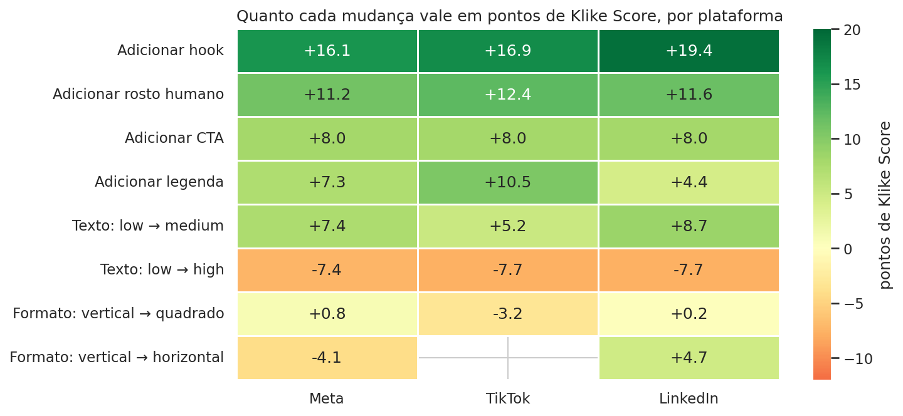

# Klike Data Science Challenge

> 🚧 Em construção: EDA, modelagem do `klike_score` e um recommendations engine para criativos em vídeo.

## Status

| Parte | Status | Onde |
|---|---|---|
| Limpeza dos dados | ✅ | `src/klike/data.py` |
| 1 · Análise exploratória | ✅ | `notebooks/01_eda.ipynb` |
| 2 · Modelagem do `klike_score` | ✅ | `notebooks/02_modeling.ipynb` |
| 3 · Recommendations engine | ⏳ | `src/klike/recommender.py`, `cli.py` |
| 4 · Visão de produto | ⏳ | este README |

## Como rodar

Requer Python 3.10+.

```bash
python3 -m venv .venv
source .venv/bin/activate
pip install -r requirements.txt
pip install -e .                      # instala o pacote local `klike` (src/klike)
python -m ipykernel install --user --name klike --display-name "Python (klike)"
jupyter lab notebooks/01_eda.ipynb   # use o kernel "Python (klike)"
```

Os notebooks estão salvos com os resultados, então dá para lê-los direto no GitHub sem executar nada.

## Estrutura

```
data/                   dataset original
docs/decisions.md       log de decisões: o que vi, o que decidi, por quê e o que descartei
docs/conceitos.md       glossário dos conceitos estatísticos usados (bootstrap, confounding etc.)
notebooks/              01 EDA · 02 modelagem · 03 demo do engine
src/klike/              código reutilizável
  data.py               carga e limpeza (correção de inconsistências)
  analysis.py           lift com IC bootstrap e efeito ajustado por regressão
  features.py           feature engineering (categorias fixas, interações por plataforma)
  model.py              comparação de modelos, treino e persistência (`python -m klike.model`)
  paths.py              caminhos do projeto
models/                 modelo treinado (gerado localmente, fora do git)
reports/figures/        figuras da EDA (eda/) e da modelagem (modelagem/)
tests/                  testes da engine
pyproject.toml          define o pacote `klike` para que notebooks e scripts importem `src/klike`
```

## Destaques da EDA (preliminar)

- **Qualidade dos dados:** 10 das 500 campanhas tinham erros de registro (impressões, spend ou CPC incoerentes com as outras colunas). Foram corrigidas por consistência interna e marcadas na coluna `data_issue`. Nenhuma linha foi descartada.
- **Hook nos 3 primeiros segundos é a alavanca mais forte:** +50–70% de CTR e score mediano de 70 contra 52 sem hook, nas três plataformas.
- **Rosto humano tem papel diferente por plataforma:** no TikTok gera clique (+75% CTR); no Meta, interação (+54% engajamento).
- **Texto demais na tela** derruba o CTR, principalmente no Meta (−48% em relação a "medium").
- **O formato depende da plataforma:** vertical é o melhor no TikTok e o pior no LinkedIn.
- **As boas práticas se somam:** o score mediano vai de 36 (nenhuma) a 81 (hook + rosto + CTA + legenda).
- **Cuidado com confounding:** no bruto, campanhas com hook têm ROAS 21% menor. Ajustando pelo contexto (principalmente a plataforma), o efeito é ≈ −2%, ou seja, nulo. Por isso a engine vai usar efeitos condicionados ao contexto, não médias globais.


Detalhes, gráficos e interpretações em `notebooks/01_eda.ipynb`; justificativas em `docs/decisions.md`.

## Destaques da modelagem (preliminar)

- **Dois modelos, por causa de vazamento de dados.** O modelo principal (A) usa só o que existe **antes** de veicular: atributos do criativo e contexto. CTR, engajamento e ROAS ficam fora, porque não existem no momento da decisão. Um modelo B com essas métricas serve só de diagnóstico.
- **Uma regressão linear simples venceu o gradient boosting** (R² 0,71 contra 0,62 na validação cruzada 5-fold × 3), com erro médio de **6,6 pontos** contra 12,6 do baseline. Isso indica que o score é construído de forma aditiva.
- **Engenharia reversa do score:** como o modelo é linear, cada coeficiente é "quantos pontos o atributo vale". Hook ≈ **+16–19 pts**, rosto ≈ +11–12, CTA ≈ +8, legenda ≈ +4–10, texto high ≈ −7–8. O formato depende da plataforma: horizontal **soma** ~5 pts no LinkedIn e **tira** ~4 no Meta.
- **O score avalia o vídeo em si:** 86–95% do valor de hook, rosto, CTA e legenda permanece mesmo controlando pelo CTR e pela retenção. O score parece ser "checklist de boas práticas + performance + ruído" (~6 pts de erro que nenhum modelo reduz).


