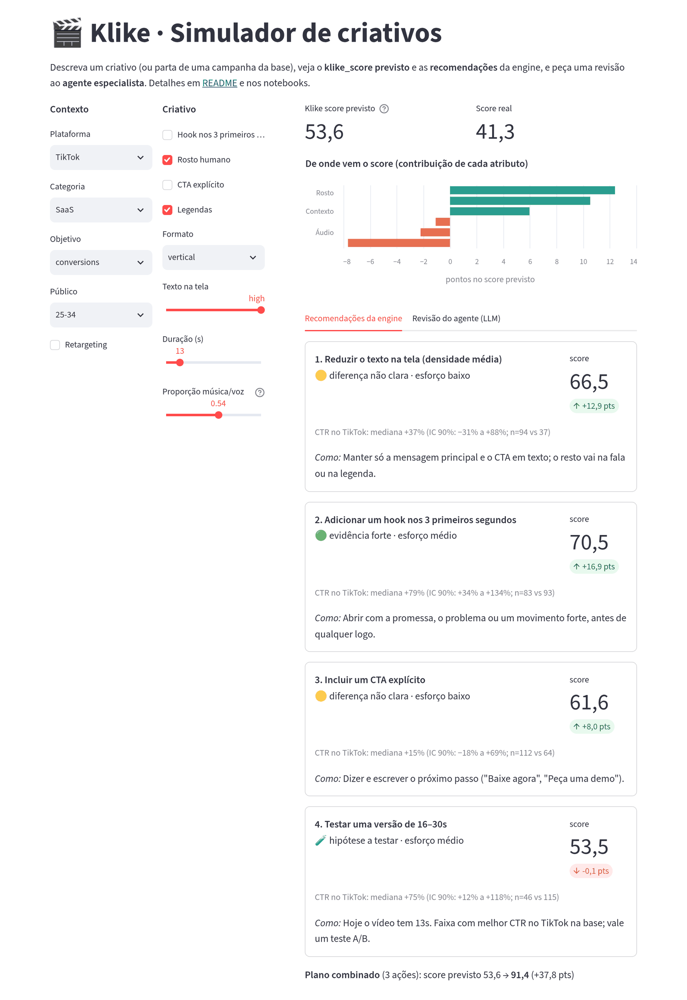
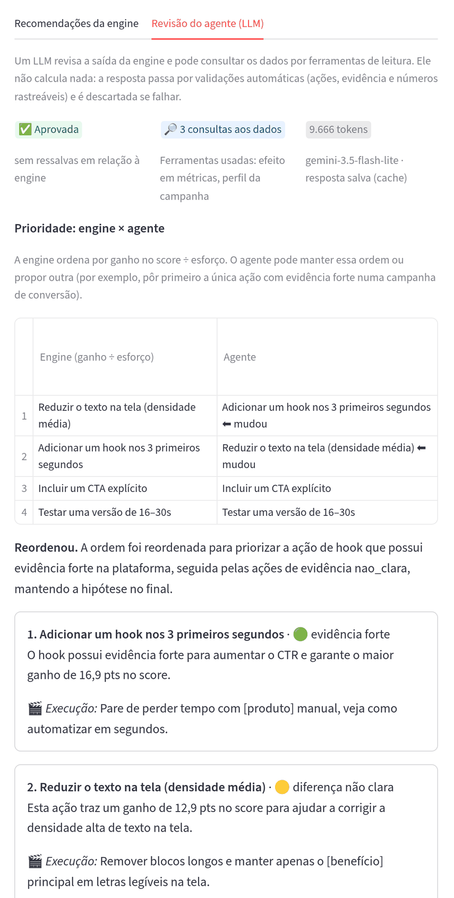
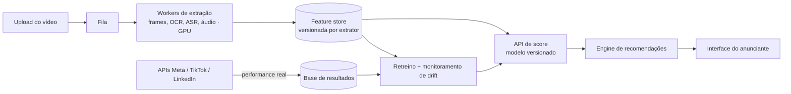

# Klike Data Science Challenge

Análise de 500 campanhas de vídeo (Meta, TikTok, LinkedIn), um modelo que prevê o `klike_score` antes do lançamento e uma engine que recomenda o que mudar no criativo. Por cima da engine, duas camadas opcionais: um simulador interativo (Streamlit) e um agente revisor (LLM) com guardrails.

## Resumo de descobertas

- **Hook nos 3 primeiros segundos é a alavanca mais forte:** vale +16 a +19 pontos de score e +50–70% de CTR no geral, com efeito positivo em cada plataforma.
- **O que funciona depende da plataforma.** Rosto gera clique no TikTok (+75% CTR) e interação no Meta (+54% engajamento); vertical é o melhor formato no TikTok e o pior no LinkedIn.
- **O score parece um checklist de boas práticas + performance + ruído.** Uma regressão linear explica 71% dele só com atributos do criativo e contexto, e venceu o gradient boosting. Por ser linear, cada coeficiente é "quantos pontos o atributo vale".
- **Cuidado com conclusões brutas:** campanhas com hook têm ROAS 21% menor, mas a diferença some (−2%) ao controlar pela plataforma. Por isso a engine compara campanhas dentro da mesma plataforma.
- **A engine** devolve ações quantificadas (pontos de score + efeito em CTR/engajamento com intervalo de confiança), priorizadas por ganho ÷ esforço, e um plano combinado.
- **Um agente LLM revisando a engine** foi aprovado nos guardrails em 17 de 18 campanhas, concordou com ela sempre que a evidência era forte e apontou um ponto fraco dela, que pode virar regra sem LLM (notebook 04).


**Exemplo** (`python cli.py --campaign-id KLK-0262 --top 2`, resumido):

```
Campanha KLK-0262 · LinkedIn · SaaS · objetivo conversions
Klike score previsto: 47,6 (real: 46,7)

1. Adicionar um hook nos 3 primeiros segundos: +19,4 pts no klike_score previsto (47,6 → 66,9).
   No LinkedIn, campanhas assim têm CTR mediano +119% (IC 90%: +29% a +239%; n=45 vs 38). Esforço: médio.
2. Aumentar um pouco o texto na tela (densidade média): +8,7 pts (47,6 → 56,2).
   No LinkedIn, a diferença no CTR não é clara (+3%; IC 90%: −29% a +90%). Esforço: baixo.

Plano combinado (4 ações): score previsto 47,6 → 91,9 (+44,3 pts).
```

## Como rodar

Requer Python 3.10+.

```bash
python3 -m venv .venv
source .venv/bin/activate
pip install -r requirements.txt
pip install -e .                                  # instala o pacote local `klike` (src/klike)

python cli.py --campaign-id KLK-0127              # recomendações (--top N, --json)
pytest                                            # testes da engine

streamlit run app.py                              # simulador de criativos (engine + agente)

python -m ipykernel install --user --name klike --display-name "Python (klike)"
jupyter lab notebooks/                            # use o kernel "Python (klike)"
```

Os notebooks estão salvos com os resultados: dá para lê-los no GitHub sem executar nada.

**Agente (opcional).** Tudo acima funciona sem chave de API: as revisões do confronto estão salvas em `reports/agent/cache/` e aparecem na UI e no notebook 04. Para revisões ao vivo, copie `.env.example` para `.env` e preencha `LLM_API_KEY` (Gemini, camada gratuita); `python scripts/run_agent_comparison.py` refaz o confronto.

## Como pensei

Cada decisão está em [`docs/decisions.md`](docs/decisions.md) no formato "o que vi → o que decidi → por quê → o que descartei" (D1–D22). Os conceitos estatísticos estão explicados em [`docs/conceitos.md`](docs/conceitos.md).

**Limpeza** · `src/klike/data.py`
- 10 campanhas tinham impressões, spend ou CPC incoerentes com as outras colunas. Corrigi o campo que contradizia os demais, confirmando com o ROAS quando possível, e marquei na coluna `data_issue`. Nenhuma linha foi descartada (D1–D2).
- Receita zero em awareness/engagement não é faltante, é estrutural: o ROAS só é analisado nos objetivos de conversão (D5).

**Parte 1 · EDA** · [`notebooks/01_eda.ipynb`](notebooks/01_eda.ipynb)
- Comparei medianas com intervalo de confiança bootstrap, porque as métricas têm cauda longa e n pequeno por grupo; e usei taxas (CTR, engajamento), não volumes, que refletem orçamento (D7–D8).
- Todo efeito foi checado por plataforma e com regressão ajustada pelo contexto, para separar efeito real de efeito de mix (D9).
- Duração tem correlação fraca com tudo (|ρ| < 0,15): virou hipótese a testar, não regra (D10).

**Parte 2 · Modelo** · [`notebooks/02_modeling.ipynb`](notebooks/02_modeling.ipynb)
- **Dois modelos, por causa de vazamento de dados.** Os dois preveem o score; o que muda é o que eles podem usar. O **A** usa só o que existe antes de veicular (criativo + contexto) e é o que a engine usa. O **B** recebe também CTR, engajamento, retenção e ROAS. Ele não serve para prever (essas métricas não existem antes do lançamento), mas a diferença entre os dois mede quanto do score vem da performance (D11).
- Validação cruzada 5-fold × 3: o linear (R² 0,71, erro médio de 6,6 pts) venceu o gradient boosting (0,62) e o baseline (erro de 12,6). Escolhi o linear também pela interpretabilidade (D12, D14).
- 86–95% do valor de hook, rosto, CTA e legenda é efeito direto no score, não via CTR; a engine usa o efeito total (D15).

**Parte 3 · Engine** · `src/klike/recommender.py`, [`notebooks/03_recommendations_demo.ipynb`](notebooks/03_recommendations_demo.ipynb)
- Para cada ação que a campanha ainda não cumpre, muda só aquele atributo e repreve com o modelo A (ganho em pontos). Ao lado, mostra o lift de CTR ou engajamento (conforme o objetivo) na mesma plataforma, com IC e n. Quando o IC cruza o zero, diz que a diferença não é clara (D16).
- Prioriza por ganho ÷ esforço: um CTA (esforço baixo) vem antes de regravar com uma pessoa (alto), mesmo valendo menos pontos (D17).
- Não recomenda o que a campanha já tem nem horizontal no TikTok; duração aparece como teste A/B; um criativo que já cumpre as boas práticas recebe menos recomendações, com aviso, em vez de sugestões inventadas (D18).

**Extra · Agente revisor e simulador** · `src/klike/agent.py`, `app.py`, [`notebooks/04_agent_comparison.ipynb`](notebooks/04_agent_comparison.ipynb)
- A engine continua sendo o núcleo. O LLM entra como **revisor com papel limitado**: lê a saída da engine, consulta os dados com 3 ferramentas só de leitura e pode reordenar, comentar, sugerir a execução criativa ("qual hook gravar") e dar alertas. Não pode criar nem remover ações, mudar a evidência ou calcular números (D19).
- **Os guardrails são código, não prompt:** schema, ações idênticas às da engine, evidência copiada, hipóteses no fim e todo número rastreável até a engine ou uma ferramenta. Se falhar, ele tem uma chance de corrigir; senão, a revisão é descartada (D20).
- **Medi em vez de supor.** No confronto com 18 campanhas, a 1ª versão teve 5 rejeições, por falsos positivos meus e problemas de formato; com uma iteração, foi para 1 (D21). O agente concordou com a engine em 7 de 7 casos em que a 1ª ação tinha evidência forte e trocou em 6 de 10 em que não tinha. Também mostrou um ponto fraco da engine: em awareness, ela mede o hook pelo engajamento, onde o efeito no TikTok não é claro; o agente consultou a retenção, que o hook aumenta em +34% nas três plataformas.
- O simulador recalcula score e recomendações a cada mudança, porque o modelo linear custa microssegundos; o agente aparece do cache ou ao vivo, com limite por sessão (D22).

| Simulador: score, contribuição de cada atributo e recomendações da engine | Revisão do agente para a mesma campanha: põe primeiro a única ação com evidência forte |
|:---:|:---:|
|  |  |

## Limitações

- **Associação, não causa.** São 500 campanhas observadas, não experimentos; cada recomendação deveria ser validada com um teste A/B.
- **Erro de ~6,6 pts** no score previsto: ganhos de 1–2 pts estão dentro do ruído.
- **Amostras pequenas em alguns cortes** (ex.: 11 campanhas verticais no LinkedIn); a engine mostra o n e evita conclusões nesses casos.
- **O plano combinado soma os efeitos**; na prática deve haver retorno decrescente.
- **O agente foi avaliado em 18 campanhas** e a qualidade da execução criativa não foi medida (exigiria avaliação humana ou A/B); a checagem de "promessa sem evidência" é uma heurística.

## Parte 4 · Visão de produto

### Que features extrair do vídeo

O dataset reduz o criativo a sim/não ("tem hook?", "tem rosto?"). O ganho mais imediato é **trocar esses booleanos por medidas contínuas**, porque o modelo já mostrou que são esses atributos que pesam:

| Hoje (booleano) | Feature extraída do vídeo | Como |
|---|---|---|
| `has_hook` | força da abertura: cortes, movimento e mudança de cena nos 3s iniciais; se há rosto, texto ou produto no 1º frame; tempo até a primeira fala | detecção de cenas, fluxo óptico, frames amostrados |
| `has_face` | % do tempo com rosto, tamanho na tela, olhar para a câmera, expressão | detector facial por frame |
| `text_density` | % da área com texto, contraste e legibilidade, texto fora das zonas seguras de cada plataforma | OCR |
| `has_cta` | momento em que o CTA aparece (só no fim? falado e escrito?) | OCR + transcrição |
| `music_voice_ratio` | separação real música × voz, volume, silêncio no início | separação de fontes de áudio |
| — | ritmo (cortes por segundo), aparição da marca/logo, cor e brilho, velocidade da fala, palavras-chave | ASR, detecção de logo |
| — | embedding do vídeo inteiro, para buscar "criativos parecidos que funcionaram" | modelo multimodal (ex.: CLIP por frame) |

### Como colocar em produção



- **Assíncrono e com cache.** A extração é o custo dominante. O vídeo entra numa fila, e o resultado fica salvo pelo hash do arquivo: reenviar o mesmo vídeo não custa nada, e editar só o CTA reprocessa pouco. O score em si (modelo linear) custa milissegundos.
- **Escala.** Amostrar frames (ex.: 2 por segundo, mais denso nos 3s iniciais) em vez de processar o vídeo inteiro; modelos leves primeiro e os pesados só quando necessário; os workers escalam pelo tamanho da fila.
- **Fechar o ciclo.** As APIs de anúncios trazem a performance real de cada criativo depois de veiculado. Isso vira dado de treino e permite medir se o score prevê resultado.
- **Monitorar.** O que funciona muda com o tempo (formatos e tendências de cada plataforma). Comparar a distribuição das features e o erro do modelo mês a mês, e retreinar quando piorar.
- **Medir a engine, não só o modelo.** Um grupo de controle que não recebe recomendações, para medir se quem as segue melhora CTR e conversão. É o que transforma as associações daqui em evidência causal.

### O que eu faria com mais tempo

1. **Validar causalidade.** Testes A/B por recomendação. Antes deles, comparar pares de campanhas quase idênticas que diferem só num atributo.
2. **Estimar efeitos em grupos pequenos sem perder confiança.** Um modelo hierárquico (bayesiano) aproveitaria plataforma × categoria, hoje descartada por n pequeno (D16): cada célula "empresta força" da média da plataforma.
3. **Incerteza no score previsto** (ex.: conformal prediction): "62 ± 8" em vez de "62".
4. **Retorno decrescente no plano combinado**, com dados suficientes para estimar interações entre ações.
5. **Esforço medido, não chutado:** usar o tempo real de produção de cada mudança, vindo do time de criação (D17).
6. **Prever o resultado de negócio, não só o score.** Com dados de mais anunciantes, modelar CTR e conversão diretamente e checar quanto o `klike_score` antecipa esses resultados.
7. **Levar para a engine o que o agente achou**, como regra determinística: medir awareness pela retenção e pesar a força da evidência na prioridade. Deixei de fora de propósito, para não invalidar o confronto já medido (D21).

## Estrutura

```
data/                  dataset original
docs/                  decisions.md (log de decisões) · conceitos.md (glossário estatístico)
notebooks/             01 EDA · 02 modelagem · 03 demo da engine · 04 confronto engine × agente
src/klike/             data.py (limpeza) · analysis.py (lift + IC) · features.py · model.py · recommender.py
                       agent.py (agente + guardrails) · agent_tools.py · agent_eval.py (métricas do confronto)
cli.py                 interface de linha de comando da engine
app.py                 simulador de criativos (Streamlit)
scripts/               run_agent_comparison.py (gera as revisões do confronto; precisa de chave)
reports/figures/       figuras da EDA (eda/), da modelagem (modelagem/) e prints do simulador (app/)
reports/agent/cache/   revisões salvas do agente (leitura sem chave de API)
tests/                 testes da engine
models/                modelo treinado (gerado na primeira execução, fora do git)
```
